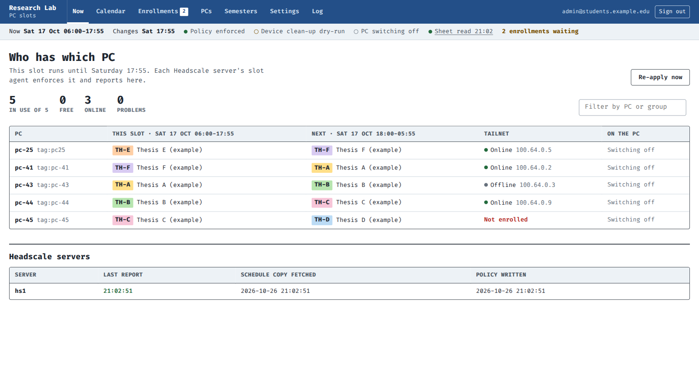
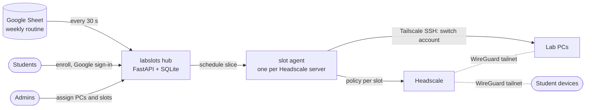
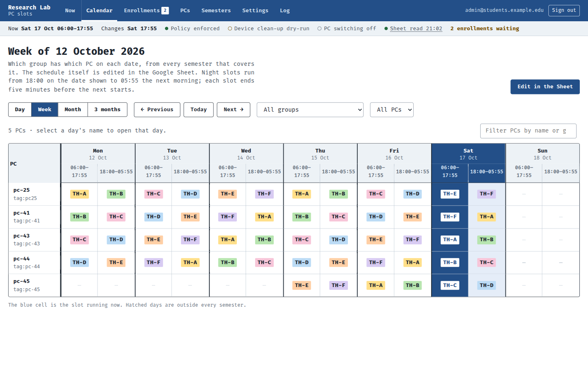
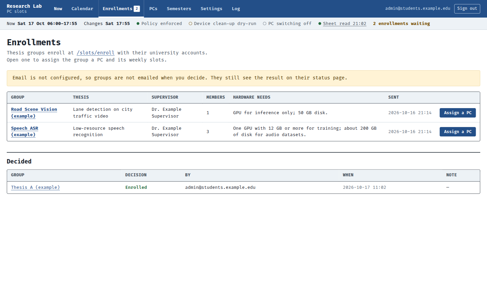

# labslots

**Time-slot access control for shared lab PCs, enforced at the network layer.**

A university research lab shares GPU PCs between thesis groups on a weekly booking routine. Before this
project the bookings were only a spreadsheet: anyone with a PC's remote-desktop ID and password could
connect at any hour and interrupt another group's training run, and nothing recorded who it was.

labslots turns the booking spreadsheet into the access control. Students join a self-hosted
[Headscale](https://github.com/juanfont/headscale) (WireGuard) network with their university Google
account. At every slot change, labslots rewrites the network policy so that **only the group whose slot is
running can reach its PC**, and switches the PC's active Linux account over Tailscale SSH. No SSH keys or
passwords are issued.



## Results

Load-tested on Docker-simulated hardware with 70 PCs, 140 groups and 800 student devices
(`labslots/stress/`, raw data in `labslots/stress/results/`):

| Measure | Result |
|---|---|
| Devices online at once (PCs, students, scheduler) | 871 |
| Slot change: new policy applied and all 70 PCs switched | 12.8–19.8 s |
| Slot change: every student access probe correct | 51–54 s |
| Wrong access after a policy change (leaks) | **0** |
| Peak memory: Headscale / hub / slot agent | 450 MB / 43 MB / 31 MB |

Plus 80 pytest cases, CI on every push, and versioned multi-arch Docker releases with a deploy script that
rolls back on a failed health check.

## How it works



- **The Sheet is the source of truth.** The hub syncs it into SQLite and keeps the last good copy if Google
  is unreachable.
- **One slot agent per Headscale server** fetches its slice of the schedule and enforces it. It keeps
  enforcing even if the hub is down, and falls back to an admins-only policy if a policy cannot be built.
- **Slot changes leave a gap.** Every slot ends five minutes before the next starts, and no group has access
  during that switch-over. The outgoing group's sessions and processes are ended.
- **Identity, not credentials.** Google OIDC signs users in. Tailscale SSH checks each caller's tailnet
  identity against the policy, so there are no keys or passwords to hand out or revoke.

| Calendar | Enrollments |
|---|---|
|  |  |

**Stack:** Python 3.11+, FastAPI, Jinja + htmx (no JS build step), SQLite, Headscale / Tailscale,
Google Sheets API and OIDC, Docker Compose, GitHub Actions, GHCR.

## Try it locally

The demo runs on illustrative data with fake Headscale and SSH backends, so it needs no accounts or network:

```sh
cd labslots
python3 -m venv .venv && .venv/bin/pip install -e '.[test]'
.venv/bin/python -m pytest
env -u PYTHONPATH .venv/bin/python devserver.py
# open http://127.0.0.1:8765/slots/dev-login?email=admin@students.example.edu
```

---

The rest of this README is the operator's reference.

## Slot model

Every PC has 14 slots a week (06:00–17:55 and 18:00–05:55, local time set by `TZ`). Each slot ends five minutes before
the next starts; in that switch-over no group has access. The weekly routine lives in a Google Sheet.
**labslots** reads it every 30 seconds. One slot agent per Headscale server then:

- writes the policy for the current slot, closing it at its end before the next group is let in;
- makes the incoming group's account the only active one on each PC, over Tailscale SSH (in the switch-over,
  no account: the outgoing group's sessions and processes end);
- optionally removes devices that are out of their slot.

## Layout

```
labslots/                    the slot system (Python 3.11+, FastAPI, SQLite)
  labslots/
    web.py                   hub: admin pages, enrollment, settings, agent API, Sheet sync loop
    sync.py                  Google Sheet -> SQLite; the Sheet is the source of truth, SQLite the last good copy
    sheets.py                Google Sheets API client (service account)
    sheet_style.py           formatting applied to the Sheet
    hub.py                   each server's slice of the schedule; agent tokens and reports
    agent.py                 slot agent: fetch the slice, enforce it, report back (keeps enforcing if the hub is down)
    enforcer.py              one enforcement run: policy, PC accounts, device clean-up
    policy.py                builds the Headscale policy: grants and Tailscale SSH rules
    headscale.py             minimal Headscale REST client
    sshexec.py               runs slot-switch on a PC over Tailscale SSH
    slots.py                 slot arithmetic
    db.py                    SQLite schema and queries
    mailer.py                outgoing email for enrollment decisions
    backup.py                nightly copies of the SQLite databases
    config.py                settings from the environment; secrets are read from files
    pc/setup-lab-pc.sh       prepares a lab PC: Tailscale SSH, the labsched account, slot-switch
    templates/, static/      Jinja pages, stylesheet, htmx
  tests/                     pytest suite
  stress/                    load tests: run.py (one host), scale.py (several hosts), results/
  Dockerfile                 the labslots image, published as ghcr.io/zamiul-rashid/labslots
  docker-compose.yml         hub, slot agent, scheduler sidecar and backup, next to Headscale
  agent-compose.yml          slot agent for an additional Headscale server
  deploy.sh                  pull a release (or build), switch, health-check, roll back
  devserver.py               local demo with illustrative data (devserver_scale.py: 70 PCs)
headscale/                   example Headscale and Headplane configuration (secrets referenced by path)
.github/workflows/           ci.yml: tests and image build; release.yml: image and GitHub release per tag
DESIGN.md                    design system for the web UI
docs/screenshots/            screenshots of the demo
```

## What runs where

| Part | How it runs |
|---|---|
| Headscale | **On the host, not in Docker**: the official `.deb` from Headscale's GitHub releases, version pinned, as the `headscale` systemd service. Config in `/etc/headscale/` (see `headscale/headscale-config.example.yaml`), data in `/var/lib/headscale/`. Upgrade it by hand with the next `.deb`, after reading Headscale's upgrade notes. |
| labslots hub, slot agent, backup | Docker, from the published image `ghcr.io/zamiul-rashid/labslots:<version>` (`labslots/docker-compose.yml`) |
| Scheduler node (`ts-scheduler`) | Docker, the upstream `tailscale/tailscale` image, pinned in the compose files |
| Headplane | Docker, the upstream `ghcr.io/tale/headplane` image (`headscale/headplane-config-and-compose.example.yaml`); reads Headscale's config read-only and never restarts it |

All containers use host networking and reach Headscale at `127.0.0.1:8080`. Headscale is never in a
container in production, and no release contains it; the backup service only reads its database. (The
load tests in `labslots/stress/` start a throwaway Headscale in Docker on a test host, for tests only.)

## Releases

Each release of labslots is a Docker image and a GitHub release with the same version number:

- `ghcr.io/zamiul-rashid/labslots:<X.Y.Z>`, plus `:<X.Y>` and `:latest`, for `linux/amd64` and `linux/arm64`;
- a release on the [Releases page](https://github.com/Zamiul-rashid/labslots/releases) saying which image
  to deploy, with the changes since the last one.

To make one: set `version` in `labslots/pyproject.toml`, commit, then tag and push the tag:

```sh
git tag v0.2.0 && git push origin v0.2.0
```

`.github/workflows/release.yml` checks the tag matches `pyproject.toml`, runs the tests, builds and pushes
the image and writes the release. `ci.yml` runs the tests and an image build on every push and pull request
but publishes nothing. The running version shows at `/slots/healthz`.

## Deployment

**Hub and first agent:** on the Headscale host, in `/opt/labslots`, with `docker-compose.yml` and
`deploy.sh` from this repo. Secrets go in `secrets/<service>/` (never committed); the comments at the end of
`docker-compose.yml` list each file.

```sh
./deploy.sh 0.2.0      # pull that release, switch to it, roll back if the health checks fail
./deploy.sh rollback   # back to the image that ran before
./deploy.sh status     # running image, kept images, container health, last backup
./deploy.sh build      # build from the source in this folder instead (unreleased code)
```

The image in use is `LABSLOTS_IMAGE` in `.env`; `deploy.sh` keeps it and the previous one there.

**More Headscale servers:** Headscale is installed there the same way (`.deb`, systemd). Register the
server under Settings → Headscale servers, then follow the steps at the top of `agent-compose.yml`. It
needs only that file and a release version in `.env`, not the source.

**Lab PCs:**
1. Join the PC to Headscale with its `tag:pc-N` pre-auth key.
2. Download the setup script from the PCs page and run `sudo bash setup-lab-pc.sh <admin-user>`.
3. Set Account switching to Yes for the PC in the Sheet's PCs tab.

Check the policy preview in Settings shows `ssh` rules **before** step 2. With Tailscale SSH on, the PC
accepts tailnet SSH only from those rules.

## Configuration

Hub (`labslots` service):

| Variable | Purpose |
|---|---|
| `LABSLOTS_PUBLIC_URL`, `LABSLOTS_BASE_PATH` | public address, e.g. `https://hs.example.org` and `/slots` |
| `LABSLOTS_BOOTSTRAP_ADMINS` | comma-separated admin emails that always exist (the Sheet's Admins tab adds more) |
| `LABSLOTS_SHEET`, `GOOGLE_SA_KEY_FILE` | the schedule Sheet's ID, and the service-account key that reads it |
| `OIDC_ISSUER`, `GOOGLE_OAUTH_CLIENT_FILE` | Google sign-in; the OAuth client JSON as downloaded |
| `LABSLOTS_STUDENT_DOMAINS` | domains students may enroll with (default `students.example.edu`) |
| `LABSLOTS_LAB_NAME`, `LABSLOTS_ORG_NAME` | the lab's name in the header and emails, and the organisation as in "your university Google account" |
| `TZ` | timezone the weekly slots are in (default `UTC`); set the same on every service |
| `SMTP_HOST`, `SMTP_PORT`, `SMTP_USER`, `SMTP_FROM`, `SMTP_PASSWORD_FILE` | email; off while host or sender is empty |
| `LABSLOTS_DATA`, `LABSLOTS_DB`, `SESSION_SECRET_FILE`, `LABSLOTS_INTERVAL`, `LABSLOTS_DEV_LOGIN` | data directory, database, session key, Sheet read interval (s), demo sign-in |

Slot agent (`labslots-agent` service):

| Variable | Purpose |
|---|---|
| `AGENT_HUB_URL`, `AGENT_TOKEN_FILE` | where the hub is, and this server's token from Settings |
| `HEADSCALE_URL`, `HEADSCALE_API_KEY_FILE` | this server's Headscale |
| `LABSLOTS_SSH_SOCKS` | the scheduler sidecar's SOCKS5 address, used for Tailscale SSH to PCs |
| `LABSLOTS_SSH_USER`, `LABSLOTS_SSH_KNOWN_HOSTS`, `AGENT_INTERVAL`, `AGENT_DB` | PC login account (`labsched`), known hosts file, run interval (s), database |

Backup (`backup` service): `BACKUP_SOURCES`, `BACKUP_DIR`, `BACKUP_KEEP_DAYS`, `BACKUP_AT`.

## Access model

The policy is rewritten at every slot change:

| Who | Network | Tailscale SSH as |
|---|---|---|
| `group:admins` | every lab PC, any port | any non-root account |
| `tag:scheduler` (the slot agent) | every lab PC, `tcp:22` | `labsched` only |
| `group:<code>` while in its slot | its PC, `tcp:22` plus the Ports setting | `grp-<code>` only |

Settings adds **Extra grants** and **Extra SSH rules** (for example the jumphost); each extra SSH rule
comes with its own `tcp:22` grant. If the policy cannot be built or applied, the agent falls back to
admins-only.

Enforcement switches, in Settings:

| Switch | Default |
|---|---|
| Policy writing | on |
| Clean-up of out-of-slot devices | dry-run |
| Removal of devices of students in no group, a day after they leave | on |
| PC account switching | off until PCs are prepared |
